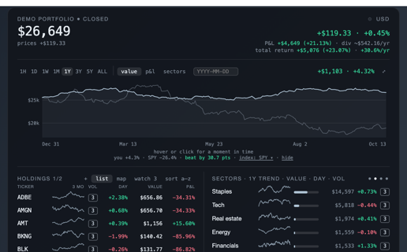

# Portfolio — an Übersicht widget

A desktop widget for [Übersicht](https://tracesof.net/uebersicht/) that tracks
a stock portfolio: total value and a value graph, your holdings as a list or a
heatmap, a volatility score for every stock, upcoming earnings and dividends,
a note and a price target per stock, a goal to aim for, and optional alerts on
big moves. Prices come from Yahoo Finance.



More pictures: [the ⚙ settings](https://github.com/onnipackalen/uebersicht-portfolio/raw/main/docs/editor.png) · [the light look](https://github.com/onnipackalen/uebersicht-portfolio/raw/main/docs/light.png) ·
[the welcome card for new users](https://github.com/onnipackalen/uebersicht-portfolio/raw/main/docs/welcome.png)

This README has three parts: a **Quick start** (install, first run, adding
your stocks, the ⚙ settings, where your data lives), a **tour** of what the
widget does, and a **reference** (every setting, the `positions.json` format,
Troubleshooting).

---

# Quick start

## Install

1. Install [Übersicht](https://tracesof.net/uebersicht/) and start it (its
   icon appears in the menu bar).
2. Download `Portfolio.widget.zip` from the
   [releases page](https://github.com/onnipackalen/uebersicht-portfolio/releases/latest)
   and unzip it into your widgets folder: click the Übersicht icon in the
   menu bar → *Open Widgets Folder*. The folder must be named
   **`Portfolio.widget`** and contain `index.jsx` directly — not
   `Portfolio.widget/Portfolio.widget`.
3. Turn on Übersicht → *Preferences* → **Enable interaction**, so the
   widget's buttons work.
4. Run the one-time setup. It installs the
   [yfinance](https://pypi.org/project/yfinance/) package into its own
   environment (`~/.portfolio-widget/venv`). Open Terminal (Spotlight →
   type *Terminal*), paste this line — GitHub's copy button at the right of
   the box copies it — and press Return:

   ```bash
   bash ~/Library/Application\ Support/Übersicht/widgets/Portfolio.widget/install.sh
   ```

   Or type `bash` and a space, then drag `install.sh` from the widget folder
   into the Terminal window, and press Return. It takes about a minute and
   prints **Done**. If you skip this step, the widget shows a **run setup in
   Terminal** button that does it for you (if your Mac asks whether Übersicht
   may control Terminal, click OK).

   Already use Python? `python3 -m pip install yfinance` works too — the
   widget finds Homebrew, python.org, pyenv, conda and the Xcode command line
   tools' Python on its own.

Needs macOS with Übersicht and Python 3.9 or newer (the one that comes with
the Xcode command line tools is fine); `install.sh` adds the one package the
widget uses, yfinance.

## First run

The widget starts with a **demo portfolio of 22 stocks**. Prices show up
within a minute; the years of history behind the 3Y/5Y tabs then download in
the background ("loading history 12/40…" under the graph — once; later
refreshes only add new days).

A **welcome card** at the top ("welcome — these 22 holdings are a demo;
replace them with yours:") walks you through the first steps with buttons:
**+ add one** or **import a list…** for your stocks, **start fresh** to
remove the demo, **⚙ portfolio settings** for your currency, index and look,
and **⚙ what it shows** for what the window displays. When you add or import
your first holding, the widget offers to **replace the 22 demo holdings
(recommended)** or **keep them**; your settings and cash stay, and a backup of
the file is kept. A new holding shows in the list at the next refresh (about
a minute).

After the demo is removed the card reads "no holdings yet — add your first:"
until you add one. It goes away by itself once the holdings are
yours; **hide** closes it earlier, and **⚙ → Portfolio → welcome card** brings
it back.

## Add your stocks

- **One at a time:** click **+**, type a company name or a ticker ("coca
  cola", `VOD.L`), pick a match, enter the shares and press Return (or
  **buy**), then confirm. Details under *Adding and selling stocks*.
- **Many at once:** **+ → import a list…** takes a pasted list (`KO 10`, one
  per line) or your broker's CSV file. See *Adding and selling stocks*.
- **By hand:** **+ → show file** reveals `positions.json`, which you can edit
  in any text editor — see *The positions.json format*.

## The ⚙ settings

**⚙** — the faint gear at the right of each window's title row (it brightens
when you point at the window) — opens that window's settings, in three
groups:

- **Portfolio** — what every window shares: name, currency, cash on hand,
  money put in, a goal to reach, history, index, headlines, alerts, target
  mix, look, background, updates, welcome card.
- **This window** — its name, size, zoom, new windows, reset.
- **What it shows** — tick the parts this window displays.

Type a word in **find a setting…** ("zoom", "news", "resize") to see only the
matching rows. Most rows have a one-line hint (**hide hints** hides them). You
rarely need to edit a file: *Settings* in the reference says where each
setting lives.

**Changed something by mistake?** For 3 minutes after a settings change, the
header of ⚙ shows **undo: …** with what you changed (for example "undo: the
index"); a click puts that one setting back. Undo goes back one change at a
time, up to 5 changes from the last day — a buy, sale or alert made since
stays as it is.

## Where your data lives

Everything stays on your Mac, in the widget folder
(`~/Library/Application Support/Übersicht/widgets/Portfolio.widget/`):

- `positions.json` — your holdings, settings, cash, alerts, notes and
  price targets (**+ → show file** shows it in Finder).
- `.cache/` — the value history the widget records, and downloaded prices.
- `positions.backup-….json` — backups: one each weekday, one before every
  import and every "start fresh", and one before each settings change (the
  newest 10 of those are kept).
- `~/Documents/Portfolio/` — CSV files, only when you click **export**.
- `~/.portfolio-widget/` — the Python environment from `install.sh`, and
  copies of the previous code after an update.

Updating keeps all of it (see *Updating*).

---

# What it does

- **Any stock Yahoo Finance lists**: US and foreign shares (`SHOP.TO`,
  `VOD.L`), ETFs, funds, crypto (`BTC-USD`), futures. Search by company name
  right in the widget.
- **Any currency mix**: each holding is converted to your currency (any code —
  USD, EUR, GBP, SEK, JPY, CHF… — picked from your Mac's region) at live
  exchange rates, and past values at that day's rate. A **currencies**
  panel shows how much sits in each currency and what currency moves did
  today and since you bought.
- **Years of history**: the graph and the day-by-day table reach back 5 years
  by default (or 3, 10, or everything — ⚙ → Portfolio → history), and to your
  earliest purchase when that is older. The long history downloads in the
  background after the first load, so the widget shows up just as fast.
- **Look up and watch any stock**: search by name, see its chart (1H to 1Y),
  moves and volatility score without adding it, and keep it on a watchlist
  that gets the same big-move alerts as your holdings.
- **What was it worth then?** Hover or click anywhere on the value graph for
  the exact value at that moment, type a date to jump to a day, or page
  through the day-by-day table.
- **Sector graphs**: how each sector has done over the hour, day, week, month
  or year, side by side on one scale.
- **Volatility score 1–10** for each stock, each sector and the whole portfolio.
- Value history with 1H/1D/1W/1M/1Y graphs, P&L against what you paid or
  against the money you put in, sector breakdown, top movers, dividends,
  earnings dates with the options-implied move.
- **Your layout**: drag it anywhere, resize it, zoom it, or split it into
  several windows — each showing just the parts you pick (graph, holdings,
  headlines, alerts…). The content adapts to the size you give it.
- **Your look**: dark, light, or whatever your Mac is set to; solid or
  see-through. A search box finds any setting; one click resets them.
- **Easy start**: a welcome card walks you through the first steps, the
  one-time setup runs from a button, and a whole portfolio can be imported at
  once from a pasted list or a CSV file. When a new version is out, the
  widget says so — one click updates it and keeps your holdings.
- **Returns that mean something**: real annual return (XIRR), time-weighted
  return, realized gains, dividends (with the next ex-dividend dates and the
  income of each year), drawdown, beta, an index to beat, a goal with your
  progress, a target mix with rebalancing trades, price alerts, a note and a
  price target per stock, CSV export and a menu-bar summary.

## Adding and selling stocks

**The + form.** Click **+**, type a company name or a ticker ("coca cola",
`VOD.L`), pick a match, enter **shares** (`10`, `2.5`) or a **money amount**
(`$1000`), and press Return or **buy**. The widget looks the stock up and asks
you to confirm with its real name and price — Return confirms that line, Esc
cancels it. Leave the price empty to use today's price; add a date in
**bought on** for older purchases (then that day's closing price is used
unless you give one) — `2024-03-01`, `01.03.2024` or `03/01/2024` (day first)
all work. After a buy the form says "added 10 × KO — in the list within a
minute", and the new row is shaded for a moment when it arrives. **sell**
works the same way (`all` sells the whole position; "sold all of KO — the
list catches up within a minute").

**look** opens the stock's detail view without adding it — price, day move,
1H/1D/1W/1M/3M/1Y chart, volatility score, next earnings — and **watch** puts
it on the watchlist (the **watch** tab next to list/map). Watched stocks show
price, day move, sparkline and volatility, and trigger the same alerts as
holdings. Click any ticker in the list, the heatmap or the watchlist for its
detail view; from there you can watch/unwatch it or start a buy.

**Many at once — import a list.** Click **+ → import a list…**, paste one
holding per line — `KO 10`, `MSFT 5 at 310 on 2024-03-01`, `SHOP.TO 12 @
61.5` — or your broker's CSV export (or **choose a file…** to pick it), press
**preview**, look over the rows (a grey line names the columns: stock,
shares, price, date, note — a row the widget could not read has its ticker
in amber), then **add N holdings**. Columns named
symbol / ticker, quantity / shares, average cost / price (or a book value,
divided by the shares) and purchase / trade date are recognised; numbers may
carry currency signs and thousands separators, dates may be `2024-03-01`,
`01.03.2024`, `03/01/2024`, `01-03-2024`, `2024/03/01` or `1 Mar 2024`.
Exchange prefixes like `TSX:SHOP` or `LSE:VOD` become `SHOP.TO` and `VOD.L`
(the preview says so); a line with two stocks on it or a price the widget is
not sure about is skipped with a note rather than guessed. A line that is not
a holding (a total row, a sale, a name without a ticker) is skipped with a
note too; nothing stops the rest. Each holding becomes a lot — a ticker you
already hold gets another lot — and a copy of the old `positions.json` is kept
next to it (`positions.backup-…-import.json`). While the demo holdings are
still there, the preview offers **replace them (recommended)** or **keep
them**, as the + form does.

**Selling records the gain.** Each sale is written to a `_realized` list in
`positions.json` — date, shares, proceeds, cost (oldest shares first) and
gain — so the **realized** line under the P&L and the **sales · realized**
panel keep your profit after the shares are gone. Sales made before version
12.7 weren't recorded and can't be recovered; add them to `_realized` by hand
if you want them counted. **Total return** = unrealized P&L + realized gains +
dividends received.

**Cash and money put in.** ⚙ → Portfolio → **cash on hand** takes money that
is not invested, one amount per currency (type `1200`, the currency, Enter or
**add**; × removes one after asking "remove CAD 1,200?" — **yes, remove** or
**no**) — it is counted in the total and used by the
rebalance panel. **money put in so far** is everything you have paid in, in
the portfolio currency; the profit line in the header can then be shown
against it (click it). Buys and sells in the widget keep it up to date. Both
take effect on the next update (about a minute).

**Dividends.** The **income · dividends** panel estimates the next 12 months
of dividends (last year's payments × the shares you hold), the yield, the
yield on cost, and draws 12 monthly bars; dividends received are estimated
from the shares you held on each payment date — lots with a purchase date,
including shares sold since 12.7 (undated lots and older sales can't be
placed in time, so they don't count). Upcoming ex-dividend dates are tagged in
the earnings list. The panel hides when nothing you hold pays.

A small switch under the yield line picks what the panel shows (each window
has its own choice; it is not saved):

- **12 months** (the default) — the 12 monthly bars above.
- **next dates** — the next ex-dividend dates of your holdings in the coming
  90 days, up to 4 rows ("+3 more in the next 90 days" lists the rest), with
  about how much the shares you hold would get. Own the shares before that
  day to get the payment. **expected** means the company has not announced it
  yet and the widget assumes about a year after last year's payment; "paid
  Nov 30" appears once the company has announced the pay day.
- **by year** — what your shares earned in each of the last 5 calendar years
  (by ex-dividend date, at today's exchange rate, "2026 so far" for this
  year) and how many holdings paid; anything older is summed in a "before …"
  row. It needs purchase dates, like the received line.

A chip is left out while there is nothing for it to show.

**Notes and price targets.** Open a stock (click its ticker) and, under its
figures, click **add a note** — a line for yourself, up to 200 characters,
like why you bought it — or **set a price target**, a price you are waiting
for in the stock's own currency (`72`, `72.50` or `72,5`). The target row then
shows how far away the price is ("72.00 USD · 8.2% away"), turns amber with
**reached** once the price gets there, and **alert me** adds a price alert at
that price, so you also get a Mac notification. Return or **save** saves,
**clear** removes, **cancel** or Esc closes the box. A **✎** after the ticker
in the list (and the watchlist) shows which stocks have one — hover it to
read them. It works for held, watched and looked-up stocks; selling
everything keeps the note, and "start fresh" removes them with the holdings.

## Reading the graph

The tabs above the graph pick the range — 1H to 1Y; **3Y**, **5Y**, **10Y**
and **MAX** (as far as the history setting allows); or **ALL** for everything
since your first purchase (or the history setting back, for holdings without
a date) — and what it shows.

**Backtest.** On 3Y/5Y/10Y/MAX the years before your first purchase show what
today's holdings would have done: that stretch is drawn lighter, a line
marks "you bought here", and hovering it says "simulated". Switch under the
graph between **as held now** (today's share counts carried back) and **as
weighted now** (today's percentages, rebalanced monthly). It's hindsight —
these are the stocks you ended up picking — and it never changes the real
part of the graph. With simulated years on screen, the change % in the corner
is time-weighted, so new money never counts as a gain.

**Index comparison.** The thin grey line is the same money put into an
index on the same days as each of your purchases; the caption reads like
"you +12.0% · SPY +9.5% · beat by 2.5 pts" and follows any start date,
backtest years included. In a narrow window the caption leaves the symbol out
when the picker beside it already names it, and wraps onto a second line
instead of cutting a word. Click **index: SPY ▾** under the graph to pick
another — popular index funds grouped by region (yours first), "auto" (the
default for your currency), "none" (no comparison, no index downloads) or
any other Yahoo symbol; **hide** / **show index** turns the line off and on.
The same choice is in ⚙ → Portfolio → compare with an index.

The graph modes:

- **value** — what the portfolio was worth. Most of it was recorded by
  the widget as it happened; stretches before you installed it, or while the
  Mac slept, are rebuilt from market prices (hovering them shows ≈) and **the
  shares you held at the time**, which is why purchase dates matter: a day
  before a purchase doesn't count those shares. A purchase shows as a step up
  in value — the change figure in the corner leaves new buys out, so it
  measures gain, not deposits.
  Holdings without a purchase date carry a small **undated** tag and count as
  held for the whole graph. A holding whose prices start later than the graph
  (a recent IPO, a renamed or delisted ticker, a foreign listing Yahoo has
  little data for) counts as cash until its first price, so there is no gap
  and no jump; the graph notes "2 holdings start later" (hover for which).
- **p&l** — value minus what the holdings cost, over time.
- **sectors** — one small chart per sector (and one for the whole portfolio),
  best performer first, all on the same % scale so sizes compare ("shared
  scale" / "best first" under the charts switch to own scales or to biggest
  holding first). It prices today's holdings back through time, so a purchase
  never looks like a gain, and it leaves nights and weekends out, so the lines
  don't turn into steps. **Click a sector to enlarge it**: a full-size chart
  with a % axis, the whole portfolio as a grey reference line, and the
  sector's stocks underneath (click one for its own chart). "‹ all sectors"
  goes back. Clicking a row in the **sectors** panel on the left opens the
  same enlarged chart.

**⤢** at the end of the tabs makes the value and p&l graphs more than twice
as tall (**⤡** shrinks them back).

**Hover** the graph and a crosshair snaps to the nearest data point and shows
the exact value and time; **click** to pin it (click it again to release). In
the sector view the crosshair runs through every chart at once. To look up a
day, type it in the date box (`2026-03-14`, or just `03-14`) — weekends and
holidays fall back to the last trading day — or open the **days** panel, a
table of each day's closing value and gain (≈ marks days rebuilt from closing
prices; the rest are the widget's own end-of-day recordings). The table shows
the newest days first; "older ›" and older dates load the rest as needed.

**Start the graph on any date:** type it in the date box (`2025-02-03`, or
`02-03` for the most recent one) and press **Enter** — or pin a moment by
clicking the graph or a day in the days panel and press **start here**. The
graph (value, p&l or sectors) then begins there, with one point per trading
day for long spans and every change figure measured from that point. The
"from Feb 3 ×" tab, or any range tab, returns to the normal ranges. History
reaches back to your earliest purchase date, however far that is; days before
you held anything aren't shown.

Inside the period the widget has been recording, rebuilt stretches
are shifted to meet the recorded values on both sides, so the line doesn't
zigzag when the two disagree — for instance after you add a holding with an
older purchase date. Before the first recording the rebuilt values stand as
they are.

The **earnings** column lists every upcoming report for your holdings and
your watchlist, 24 at a time — "later ›" pages through the rest.

## Targets and rebalancing

Tell the widget what mix you're aiming for in **⚙ → Portfolio → target mix**,
in percent of everything (holdings and cash). While none is set the row reads
"not set — the rebalancing panel needs one", with two chips:

- **set one** — an empty row for each of your sectors, plus cash;
- **start from today's mix** — the same rows filled in with each sector's
  share today (adding up to 100 %), so you only change what you want.

Type a % in each row; an empty row counts as 0 %. **by holding** next to a
sector splits it into its holdings, each with its own % (**as one** joins it
again). The line at the top adds it up as you type: "adds up to 100 % ✓",
"7 % left to place" or "3 % too much — lower a row"; a field turns red when it
is not a number from 0 to 100. Press Return in any field or click **save
target mix** — it takes effect on the next update (about a minute). **undo
changes** goes back to the saved mix, **use today's mix** fills in today's
shares, and **remove target mix** (it asks first) turns all of this off.
Unsaved changes are dropped when you close ⚙. A stock you no longer hold is
named ("not held any more: … — left out when you save").

With a target mix, each holding gets a small **off-target** badge
(percentage points above or below target; orange when over), the heatmap gets
a **drift** tab that colours each tile by how far it is off target, and a **rebalance** panel lists the trades that move
the fewest dollars to get everything within ±1 point of target — in whole
shares or fractional, never spending cash you don't have — plus where new
money should go first. Click the panel's heading to open the target mix in
⚙. ⚙ → Portfolio → **rebalancing suggests** picks whole shares, fractions of
a share, or lets the widget choose. Holdings without a target count as 0%.
With no target mix, none of this shows.

The mix is saved as `_settings.targets` (sector names as the widget shows
them, tickers, and `"cash"`):

```json
"targets": {"Tech": 30, "Health care": 20, "Financials": 15, "KO": 10, "cash": 5, "Energy": 20}
```

You can still write it by hand, or from Terminal:
`python3 set_setting.py targets '{"Tech": 30, "KO": 10, "cash": 5}'`
(`targets default` removes it). A name that is not one of your holdings,
sectors or cash is refused, and so is a ticker whose sector has a % too —
give one or the other.

## Returns and risk

After 30 days of history the header shows your **real annual return**, e.g.
"+12.0% total · 9.8%/yr": a money-weighted rate (XIRR) where every purchase is
money out and sales, dividends and today's value are money in, each at that
day's exchange rate (cash is left out). Hover it for the **time-weighted**
return too — the holdings' own growth, no matter when you added money. Younger
portfolios see a short note instead of a number that would mean little. The
**risk** panel adds the **drawdown** (how far below its peak the portfolio is
now, and the worst drop with its date), **beta** against your index and the
**Sharpe ratio** ((annual return − 4%) ÷ annual volatility). The same figures
for the backtest years are shown separately, labelled e.g. "(backtest, 10y)".
Hover a holding for its 52-week closing high.

**A goal.** In ⚙ → Portfolio → **a goal to reach**, type an amount and a
year (`250000` by `2035`) or a day (`2035-06-30`), then Return or **save**
(**remove** takes it away). The header then gets a goal line like "goal
$250,000 by 2035 · 40%" with a small progress bar. After a year of history
it also says whether your annual return so far gets you there — **on
track** (green) or e.g. "29% short at your pace so far" (just "29% short" in
a narrow window) — and later **reached** or **date passed**. Hover it for the
arithmetic: today's holdings grown at your money-weighted annual return
until the goal date, cash counted as it is, and the yearly return you would
need. It is simple arithmetic on your past return, not a forecast. The goal
is kept in the currency you set it in; if you change the portfolio currency
and no exchange rate is known, ⚙ asks you to save it again. Switch the line
off per window in ⚙ → What it shows → **goal**.

## Currencies

When you hold anything outside your display currency (a US stock in a CAD
portfolio, cash in another currency), a **currencies** panel shows, biggest
first: each currency's share of the portfolio (cash included) with a bar,
its value, and what that currency's move did today. Under the rows:

- **today: prices … · currency moves …** — today's change, split into the
  share prices moving and the currencies moving against yours.
- **since you bought: prices … · currency moves …** — the gain on what you
  hold now, split the same way. "prices" is the P&L in the header (counted at
  today's exchange rates); "currency moves" is what the exchange rate added or
  took away since each purchase, using that day's rate. Hover for the total.

Hover a currency for today's rate and the average rate you bought at. The
move since purchase shows "—" when it can't be worked out — a holding in that
currency has no purchase date or no purchase price, or the older exchange
rates are still loading. The panel hides when everything is in one currency;
switch it in ⚙ → What it shows → **currencies**.

## Volatility scores

Each stock gets its **annualized volatility**: how much its price has been
swinging, measured as the standard deviation of daily returns over the last 3
months, scaled to a year. The **score** is simply that number divided by ten,
kept between 1 and 10:

| score | volatility | feels like |
|---|---|---|
| 1–2 | under 20%/yr | very calm / calm: utilities, consumer staples |
| 3–4 | 20–40% | moderate: most large companies |
| 5–6 | 40–60% | lively: fast-growing tech |
| 7–8 | 60–80% | wild: chip makers, turnarounds |
| 9–10 | 80%+ | extreme: speculative small caps, crypto |

The scale is fixed, so a 6 means the same in every portfolio and doesn't
change when you add stocks. The **risk** panel shows the portfolio's own
volatility next to the average of its holdings — the gap is what
diversification buys you — plus the wildest and calmest names. Switch the
heatmap to **vol** to color tiles by score. Past volatility describes how a
stock *has* moved, not a forecast.

## Windows, size and what's shown

**Move** a window by dragging its **title row** (double-click the ⠿ grip for
the default spot). **Resize** it by dragging its right edge, bottom edge or
bottom-right corner (they appear on hover) — this changes the real width and
height, and the content adjusts: one column when narrow, two or three when
wide, a bigger or smaller graph, more or fewer rows, and panels folding away
when there isn't room ("+N hidden — ⚙" says what). Double-click an edge to go
back to the default width or to "fit content". In a window narrower than
400 px the graph's date box is left out, the change figure and ⤢ move to the
end of the tabs line, and the ⚙ title drops the window's name.

A long holdings list is paged and turns a page every 30 s, starting on page 1:
click ‹ › or a dot to stay on a page (⌖ shows it is held; click the dot again
to let it turn), or the N/N count for the next page. A small line under the
HOLDINGS header names the columns (ticker · 3 mo · vol · day · value · p&l —
only those that fit); hover one for what it means.

In the **heatmap**, two or more holdings of one sector that are too small for
a label are joined into one "+3" tile (it cannot be clicked); hover it for
which holdings they are, their value and how they moved together.

**⚙** (the faint gear at the right of the title row; it brightens when you
point at the window) opens the settings for that window — three groups, most
rows with a one-line hint (the **hide hints** chip hides the hints). The
**find a setting…** box at the top shows only the rows whose name or hint
contains what you type ("zoom", "news", "resize", "dividends", "since",
"muted"…), across all three groups — the news page options included.

- **Portfolio** — settings the whole portfolio shares, no file editing
  needed: **portfolio name**, **currency**, **cash on hand**, **money put in
  so far**, **a goal to reach** (see *Returns and risk*), **history** (3 · 5
  · 10 years · everything), **compare with an index**, **headlines** on/off,
  **big-move alerts** on/off with both thresholds, **target mix** (see
  *Targets and rebalancing*), **rebalancing suggests** (once a target mix is
  set), the **look**
  (dark · light · follow my Mac), the **background** (a slider from glass to
  solid, 30–100 %, live as you drag; quick picks normal and lighter),
  **updates** (check once a day · never · check now) and the **welcome card**
  (show · hide). **reset portfolio settings** puts currency, history, index,
  headlines, alerts, rebalancing, look, background, updates and the welcome
  card back to their defaults — your holdings, the name, the target mix, the
  goal, windows, cash and money put in stay. **undo: …** in the ⚙ header puts
  the last change back (see *The ⚙ settings*). A change that needs new prices says "takes
  effect on the next update (about a minute)" until it has; a longer history
  says "loading more history — the graph fills in over the next few minutes".
- **This window** — its **window name** (empty = the portfolio's name),
  **collapse to one line**, **size** (narrow · normal · wide, or custom width
  and height; empty height = fit content), **zoom**, **left-side boxes**
  (today, sectors, risk and days taking turns, or all stacked), **+ new
  window ▾** from a template (full, graph only, holdings, news & alerts, news
  page, ticker line, blank; up to 8 windows), duplicate, remove, **reset this
  window** and **reset all windows**.
- **What it shows** — tick the parts this window displays: the top numbers,
  the graph and its buttons, each panel, the holdings list and its views,
  the columns of every holding row, the bottom line. Hover a name for what it
  is. **to top** next to a panel puts it first in its column. The **arrange**
  switch reveals the expert controls: order (↑ ↓), left / right column, what
  hides first when the window is short (hide last · normal · hide first),
  and move to another window. A part (a range tab, the index line…) shows
  only while its block (the graph…) is on.

Columns balance themselves: a panel whose column you never picked goes to
whichever side is shorter so far, so the left side doesn't run far below the
right as you switch panels on and off; a column you picked is kept, and the
holdings list stays left unless you move it.

Each window keeps its own range, mode, page and view. Everything is saved in
`_settings.display` and survives restarts; without it you get the single
default widget. Adding a **news** panel turns headlines on.

### News page

The news panel shows the day's movers' headlines. A **news page** shows
headlines for whatever you choose — every holding, the watchlist, tickers
you type — with its own order, time span and layout, per window.

To add one: **⚙ → + new window → news page** (a 480×560 window with a news
panel set to every holding and the watchlist, 5 headlines per stock, newest
first; it turns headlines on). Or switch the **news** panel on in any window:
its options appear under it in the editor's features list, and clicking any
of them turns that panel into a news page (a news panel you never touch
keeps working as before). The **⚙** chip next to the panel's "news" line
opens the editor at those options.

| in the editor | JSON key (`windows[i].news`) | values | default |
|---|---|---|---|
| **whose**: movers · holdings · watchlist · both · pick… | `scope` | `movers`, `holdings`, `watch`, `all`, `pick` | `movers` — holdings moving more than 3% today, as before |
| **tickers** (a box shown for pick…; Enter or click away keeps them, Esc reverts; each accepted ticker becomes a chip with ×, a wrong one says "not a ticker") | `tickers` | up to 40 symbols, held or not | `[]` |
| **per stock**: 1 · 3 · 5 · 10 | `per` | 1–10 (Yahoo gives about 10) | `3` |
| **order**: newest · movers · A–Z | `sort` | `new`, `move`, `ticker` | `move` — biggest movers first, the stock open in that window first of all |
| **since**: today · 3 days · week · all | `span` | `day`, `3d`, `week`, `all` | `all` |
| **layout**: dense | `dense` | `true` / `false` | `false` — one 14 px line per story instead of title + source line |
| **layout**: group by ticker | `group` | `true` / `false` | `false` — a heading per ticker ("KO · +2.1% · 3") |
| **layout**: source | `sources` | `true` / `false` | `true` — show the source and the time |
| **market news**: CNBC · MarketWatch · Yahoo Finance · FT | `market` | any of `cnbc`, `marketwatch`, `yahoo`, `ft` | `[]` — the news page template turns on CNBC, MarketWatch and FT (Yahoo Finance's feed runs days behind) |
| **muted**: one chip per hidden ticker, **unmute all** | `mute` | up to 40 symbols | `[]` |
| **keyword** (read-only chip; typed in the panel) | `q` | up to 60 characters | `""` |

Inside the panel: the **filter box** narrows the feed as you type (title,
source or ticker); **Enter** saves the keyword (`q`), **Esc** clears it. In a
column narrower than 240 px the box appears only while a keyword is set.
Clicking a **ticker tag** opens that stock's detail when the window has a
holdings panel, otherwise it narrows the feed to that ticker. **×** next to a
tag (on hover) mutes the ticker in that window. The line under the rows says
when headlines were last fetched, "fetching N more…" while some are still
on their way, "N unavailable" when Yahoo had none, and offers chips to clear
an active filter, mute list or time span. A story about several of your
tickers is shown once with all of them. Default options are not saved: a news
page with the defaults is `"news": {}`.

**Market news** mixes the outlets' latest stories into the page (their public
feeds, fetched every 15 minutes, nothing older than 3 days), tagged with the
outlet's name; a tag click narrows the page to that outlet. WSJ's public
feeds stopped updating in 2025, so they aren't offered. Yahoo's newest item
for a thinly covered stock can be months old: the movers panel hides anything
older than a week, and the template starts on "this week" (**since → all**
shows everything).

Requests: with a news page Yahoo is asked for the headlines of every held,
watched or picked symbol in scope — not only today's movers — and so sees
which symbols you follow (see Privacy). The tracker asks for one request per
symbol per 30 minutes, at most 12 per refresh (4 at a time), so a page for
60 holdings fills over several refreshes; with more than 72 symbols in scope
some are always waiting. Each market feed is one plain request to that
publisher every 15 minutes (no symbols, nothing about you; see Privacy).
Changing the options never causes extra requests, except a new scope or a
newly picked ticker (at most one such refresh per minute). A symbol Yahoo has
no headlines for is retried after 10 minutes, then every 30.

## Compact mode, export, backups, menu bar

**Compact mode.** Click the widget's title to fold it into one line — total,
today's % and $, and a small sparkline. Click the title again to open it. It
stays folded after Übersicht restarts, and dragging the title still moves the
widget. (**⚙ → This window → collapse to one line** does the same for one
window.)

**Export.** "export" in the footer writes four CSV files to
`~/Documents/Portfolio/` and shows them in Finder: `holdings.csv` (each
purchase with its cost, plus cash), `daily_values.csv` (the whole day-by-day
history with the money put in and the index), `sales.csv` (sales recorded
since 12.7) and `dividends.csv` (every dividend your shares earned, by
ex-dividend date — holdings you own now, dated purchases and recorded sales
only — at today's exchange rate). They open in Numbers and Excel (UTF-8, ISO dates, plain numbers;
in Excel with a comma as decimal separator, use Data → From Text). macOS may
ask once whether Übersicht may use your Documents folder. From Terminal:
`python3 export.py`, or `PORTFOLIO_EXPORT_DIR=/some/folder python3 export.py`.

**Daily backup.** Once a weekday after the US market closes, the widget copies
`positions.json` to `positions.backup-YYYYMMDD-HHMMSS-daily.json` in the widget
folder and keeps the newest 30. "Start fresh" backups (`--reset-all`) are
never touched. To restore, copy a backup over `positions.json`.

**Settings backups.** Every settings change first saves a copy of
`positions.json` (`positions.backup-YYYYMMDD-HHMMSS-setting.json`, at most
one every 10 seconds, the newest 10 kept), and ⚙ can undo the last change:
it puts back only that setting, so a buy or sale made since is kept. Undo
goes back one change at a time, up to 5 changes from the last day. Quick
repeated changes to the same setting within 10 seconds (like a drag or a
slider) count as one change. From Terminal: `python3 set_setting.py undo`.

**Menu bar** (optional, with [SwiftBar](https://swiftbar.app) or
[xbar](https://xbarapp.com)): shows e.g. "$32.3k +0.8%" and a small dropdown,
read from the widget's last refresh — it never downloads anything itself, so
Übersicht must be running. Link the script into your plugins folder with a
refresh interval in its name:

```bash
ln -s ~/Library/Application\ Support/Übersicht/widgets/Portfolio.widget/menubar.sh \
      ~/path/to/your/SwiftBar/Plugins/portfolio.1m.sh
```

(xbar's folder is `~/Library/Application Support/xbar/plugins`.) If the widget
lives somewhere else, set `PORTFOLIO_WIDGET_DIR` for the plugin.

## Updating

When a newer version is out, the bottom row says **update 13.6 ▸**; click it
and then **yes, update**. The widget downloads the release, keeps your
`positions.json`, its backups, `python.txt` and the `.cache/` folder (the
value history), copies the old code to `~/.portfolio-widget/backups/` (the
newest three are kept), swaps the files and reloads by itself — "updated to
13.6 ✓" then shows for a while. **what's new** opens the release notes,
**later** hides the offer until the next version. ⚙ → Portfolio → updates →
**check now** asks right away.

By hand: `bash update.sh` in the widget folder does the same (it needs
`curl` and `unzip`, both part of macOS), or replace the code files yourself
and keep the data files named above. Settings and files from older versions
keep working.

If an update fails half-way, it puts the old files back by itself ("the
update could not finish — still on 13.5, nothing lost"). If even that fails,
the bottom row says to reinstall from the releases page — your holdings are
never touched, and a copy of the old code is in `~/.portfolio-widget/backups/`.

## Privacy

- Everything stays on your Mac: your holdings in `positions.json`, the value
  history in `.cache/`, backups in the widget folder, exports in
  `~/Documents/Portfolio/` (only when you click export). No account, no
  analytics, no server of this project's.
- The only requests for prices go to Yahoo Finance, through yfinance: prices
  and history for your tickers, the index and exchange rates (about every 5
  minutes while your markets are open, every 30 minutes when they are
  closed), your searches in the + form, and headlines only when headlines are
  on. Yahoo sees which symbols are asked for — never how many shares you hold
  or what you paid. With the plain news panel that means the holdings that
  moved more than 3% today; with a news page it is every symbol in that
  page's scope — all your holdings, the watchlist, or the tickers you picked.
- **How often it asks Yahoo:** each refresh, one price request per holding;
  the daily and hourly bars hourly while a market is open and once more after
  each close (not again at night or at weekends); earnings and dividends once
  a day, at most 20 holdings per refresh (new holdings at once — with 40+
  holdings the daily check spreads over a few refreshes); the long history
  once after install, two downloads at a time, once the first prices are a
  minute or two old (if Yahoo says "too many requests" it stops and
  fetches the rest about 30 minutes later). A refresh comes every 4½ minutes while a market you
  hold or watch is open, every 15 minutes around the US session (pre-market
  and after-hours), and every 30 minutes when all are closed — never later
  than the next open. A crypto or currency you hold or watch counts as always
  open, so it keeps the 4½ minutes. A buy or sale fetches at once. Hover
  "updated … ago" in the bottom row to see when the next check is while the
  markets are closed.
- With **market news** on, CNBC, MarketWatch, Yahoo Finance and/or FT get a
  plain request for their public headline feed every 15 minutes — no
  symbols, no account, nothing about your portfolio.
- With **updates** on (the default) the widget asks GitHub once a day for the
  newest release: one plain request to `api.github.com`, nothing about your
  portfolio in it. ⚙ → Portfolio → updates → **never** (`updates: false`)
  stops it; **check now** still works when you ask. Updating downloads the
  release zip from GitHub.
- Sharing a screenshot shows your numbers; the demo portfolio is there for
  that.

---

# Reference

## Settings

In `positions.json`, under `"_settings"`. Every key is optional — leave one
out for its default. You rarely need the file: the **where** column says
where each one is set in the widget. ⚙ → Portfolio holds the ones every
window shares, the graph's buttons and the title set a few more, and ⚙ →
This window holds each window's name, size and zoom. Only the old
`position` / `scale` are set in the file alone.

| key | default | what it does | where to change it |
|---|---|---|---|
| `title` | `"portfolio"` | the name in the title row | ⚙ → Portfolio → portfolio name |
| `currency` | `"auto"` | the currency everything is shown in | ⚙ → Portfolio → currency |
| `cash` | none | money not invested, per currency — counted in the total; stored as `_cash` next to `_settings` | ⚙ → Portfolio → cash on hand |
| `invested` | none | everything paid in so far — the header's profit can be shown against it; stored as `_invested` | ⚙ → Portfolio → money put in so far |
| `goal` | none | an amount to reach by a date: `{"value": 250000, "date": "2035-12-31", "cur": "CAD"}` — the header's goal line | ⚙ → Portfolio → a goal to reach |
| `backtestYears` | `5` | how far back the price history goes: `3`, `5`, `10` or `"max"` | ⚙ → Portfolio → history |
| `benchmark` | `"auto"` | the index on the graph | ⚙ → Portfolio → compare with an index, or **index: … ▾** under the graph |
| `showBenchmark` | `true` | the index line shown | **hide** / **show index** under the graph |
| `graphBig` | `false` | the taller graph | **⤢** / **⤡** |
| `compact` | `false` | folded to one line | click the title |
| `news` | `false` | headlines — no headline requests at all while off | ⚙ → Portfolio → headlines |
| `alerts` | `false` | a notification when a holding or the portfolio moves a lot in a day | ⚙ → Portfolio → big-move alerts |
| `alertThreshold` | `5` | the daily move (%) of one holding that alerts | ⚙ → Portfolio, once alerts are on |
| `portfolioAlertThreshold` | `2.5` | the daily move (%) of the whole portfolio that alerts | ⚙ → Portfolio, once alerts are on |
| `targets` | none | your target mix, for the off-target badges and rebalancing | ⚙ → Portfolio → target mix |
| `rebalanceWhole` | automatic | rebalance in whole shares (`true`) or fractional (`false`) | ⚙ → Portfolio → rebalancing suggests, once a target mix is set |
| `display` | none | your windows and what each shows, incl. a window's news page options (`news`) | ⚙ → This window and What it shows |
| `position`, `scale` | none | the single window's spot and zoom from before windows existed | the file only (from before windows) |
| `theme` | `"dark"` | the look: `"dark"`, `"light"` or `"auto"` (follows the Mac's appearance) | ⚙ → Portfolio → look |
| `opacity` | `0.88` | how solid the window's background is, `0.3` (glass) to `1` (solid) | ⚙ → Portfolio → background (a slider) |
| `updates` | `true` | look for a newer version on GitHub once a day (**update … ▸** in the bottom row) | ⚙ → Portfolio → updates |
| `welcome` | `true` | the welcome card, shown while the holdings are still the demo's or there are none yet | ⚙ → Portfolio → welcome card, or the card's **hide** |

For example:

```json
"_settings": {
  "title": "my stocks",
  "currency": "EUR",
  "backtestYears": 10,
  "benchmark": "IWDA.AS",
  "news": true,
  "alerts": true,
  "alertThreshold": 4
}
```

Next to `_settings` the file can also hold `_invested` and `_cash` (both can
be set in the widget, see above), `_watch` and `_notes` (see *The
positions.json format*), `_alerts` (below) and `_realized` (written when you
sell). Other keys starting with `_` are ignored, so `"_comment": "…"` is a
safe place for a comment.

In detail:

- `currency`: any currency code — `"USD"`, `"EUR"`, `"GBP"`, `"SEK"`, `"JPY"`,
  `"CHF"`, `"AUD"`… — or `"auto"` (default): your Mac's region decides
  (System Settings → General → Language & Region). Holdings in other
  currencies are converted at live rates, and past values at that day's rate.
- `cash` / `invested`: see *Cash and money put in*. Money put in is in the
  portfolio currency and is not converted if you change the currency later.
- `backtestYears`: how far back the price history goes — `3`, `5` (default),
  `10` or `"max"` (everything Yahoo has). Purchases older than that still
  reach back to their purchase date. It also decides which backtest tabs
  appear (3 → 3Y; 5 → 3Y, 5Y; 10 → also 10Y; "max" → also MAX).
- `benchmark`: the index on the graph — any Yahoo symbol (`"VT"`, `"^GSPC"`,
  `"IWDA.AS"`…), `"none"` to hide it, or `"auto"` (default): SPY for USD,
  XIU.TO for CAD, EXW1.DE for EUR, ISF.L for GBP, STW.AX for AUD, 1306.T for
  JPY, CSSMI.SW for CHF, 2800.HK for HKD, and ACWI (converted) for any other
  currency. Easiest: click "index: … ▾" under the graph and pick from popular
  index funds (SPY, QQQ, VTI, DIA, IWM, VT, ACWI, EFA, EEM, XIU.TO, XIC.TO,
  VFV.TO, XEQT.TO, EXW1.DE, IWDA.AS, ISF.L) or type any symbol.
- `goal`: set in ⚙ → Portfolio → a goal to reach (see *Returns and risk*).
  From Terminal: `python3 set_setting.py goal 'CAD 250000 2035'` — a
  currency, an amount (`250000`, `250 000` or `250,000`) and a year (meaning
  Dec 31) or a day like `2035-06-30`; the date must be after today and within
  60 years. `goal default` removes it.
- `targets` / `rebalanceWhole`: your target mix (see *Targets and
  rebalancing*) and whether the rebalance panel suggests whole shares (`true`)
  or fractional (`false`; unset = whole shares when all your holdings are).
- `showBenchmark` / `graphBig`: whether the index line is shown and whether
  the graph is enlarged. The widget sets them for you when you click "hide" /
  "show index" or ⤢ / ⤡ (`widget_command.sh setting showBenchmark false` does
  the same from Terminal).
- `display`: your windows and what each shows — set by the ⚙ editor; its
  shape is under *The display setting* below.
- `position` / `scale`: the default window's spot and zoom from before
  windows existed (still honoured; the editor moves them into `display`).
- `alerts`: a macOS notification when a holding moves more than
  `alertThreshold` % in a day, or the whole portfolio more than
  `portfolioAlertThreshold` %. Once per stock per trading day. Notifications
  come from Script Editor, so allow it under System Settings → Notifications.
- `news`: `true` shows the latest headlines in a stock's detail view and marks
  holdings moving more than 3% (default `false`: no headline requests at all).
- `theme` / `opacity`: the look. `"auto"` follows System Settings →
  Appearance and switches when the Mac does. The opacity is set with the
  slider at ⚙ → Portfolio → background (30–100 %); it is the card's
  background only — text and graphs stay solid.
- `updates`: once a day the widget asks GitHub for its newest release and,
  when that is newer, offers it in the bottom row (see *Updating*). `false`
  = no requests to GitHub; ⚙ → Portfolio → updates → **check now** still
  works when you ask.
- `welcome`: the card with the first steps, shown while the holdings are
  still the demo's or there are none yet; **hide** sets it to `false`, and
  **reset portfolio settings** brings it back.

From Terminal, in the widget folder, `python3 set_setting.py KEY VALUE` sets
any of these the way the widget does (`default` removes one, e.g.
`python3 set_setting.py opacity 70%` or `python3 set_setting.py cash 'CAD 1200'`),
and `python3 set_setting.py undo` puts the last change back, like **undo** in ⚙.

**Price alerts** live next to `_settings` in a `_alerts` list — separate from
the daily-move `alerts` above, and on whenever the list has entries:

```json
"_alerts": [
  {"ticker": "KO", "above": 70},
  {"ticker": "KO", "below": 55},
  {"ticker": "MSFT", "pctFromCost": -20},
  {"ticker": "*", "drawdownPct": 15}
]
```

`above` / `below` are prices in the stock's own currency; `pctFromCost` is the
change from what you paid (needs a purchase price or date); `"*"` with
`drawdownPct` watches the whole portfolio's drop from its peak. Each fires
once when crossed and re-arms after the price crosses back. Add and remove them
in a stock's detail view ("alert at…", ×), in the **price alerts** panel, or
from Terminal: `python3 alerts.py add KO above 70`, `python3 alerts.py list`,
`python3 alerts.py remove <id>`.

## The positions.json format

Holdings live in `positions.json` in the widget folder (**+ → show file**
reveals it). The simplest form is ticker → shares:

```json
{
  "MSFT": 10,
  "SHOP.TO": 25,
  "VOD.L": 300
}
```

Add a cost and date to get P&L, and several lots if you bought in stages:

```json
{
  "MSFT": { "shares": 10, "avgCost": 412.30, "purchaseDate": "2025-03-14" },
  "VZ": { "lots": [
    { "shares": 5, "date": "2024-11-01", "avgCost": 40.00 },
    { "shares": 2, "date": "2025-06-02" }
  ], "theme": "Telecom" }
}
```

- `avgCost` is per share, in the stock's own currency. Without it, the
  closing price on `purchaseDate` is used (marked **≈** in the widget).
- `theme` groups holdings in the heatmap and sector list; untagged stocks use
  Yahoo's sector.
- `_invested` (optional): the total money you've put in, in your display
  currency — enables the "vs invested" P&L view. Set it in ⚙ → Portfolio →
  money put in so far; in the file it is a plain number. Buys and sells made
  in the widget update it for you. It is not converted if you change the
  currency later.
- `_cash` (optional): set it in ⚙ → Portfolio → cash on hand; in the file it
  is `{"USD": 1200, "CAD": 300}`, added to the total.
- `_watch` (optional): `["AMD", "SHOP.TO", "BTC-USD"]` — tickers to monitor
  without holding them.
- `_notes` (optional): a note and a price target per stock, set in its
  detail view (see *Notes and price targets*):
  `{"KO": {"note": "bought after the Q3 call", "target": 72.0, "side": "above", "at": "2026-10-21"}}`.
  `target` is in the stock's own currency (pence for `.L`), `side` says
  whether it was above or below the price when saved, `at` is the day it was
  written; only the fields that are set are stored. At most 500 stocks, a
  note at most 200 characters.
- `_settings`, `_alerts`, `_realized`: see *Settings* and *Adding and
  selling stocks*.

From Terminal, the same helpers the widget uses:

```bash
cd ~/Library/Application\ Support/Übersicht/widgets/Portfolio.widget
python3 ticker_lookup.py search "shopify"
python3 add_position.py SHOP.TO 10
python3 add_position.py MSFT --amount 1000
python3 remove_position.py MSFT 5 --price 190
python3 remove_position.py --reset-all      # start over (backup kept; keeps your settings and cash)
python3 watchlist.py add AMD                # monitor without holding
python3 holding_meta.py note KO bought after the Q3 call   # a note (13.6)
python3 holding_meta.py target KO 72        # a price target; "clear" removes it
python3 holding_meta.py list                # every note and price target
python3 ticker_lookup.py look AMD           # detail + chart data as JSON
python3 import_positions.py --file ~/Downloads/holdings.csv            # import preview
python3 import_positions.py --file ~/Downloads/holdings.csv --commit   # import for real
```

## The display setting

`_settings.display` holds your windows and what each shows. The ⚙ editor
writes it; you rarely need to touch it. Its shape:

```json
"display": {"windows": [{"id": "main", "title": "…", "x": 40, "y": 40,
  "w": 664, "h": "auto", "zoom": 1,
  "items": ["graph", "panel.news", "…"], "prio": {"panel.news": "always"},
  "side": {"…": "…"}, "carousel": "rotate",
  "news": {"scope": "all", "per": 5}}]}
```

1–8 windows; the feature ids are the `id`s in `FEATURES` near the top of
`index.jsx` (13.6 adds `header.goal` and `panel.currencies`); a window's
`news` object holds its news page options (see *News page* — leave it out for
the plain news panel). Remove `display` to get the default single widget
back, or in Terminal (in the widget folder) run
`python3 set_setting.py display reset-all`.

## Troubleshooting

Find what you see, then do what it says.

- **The widget does not appear at all.** Check that Übersicht is running (its
  icon in the menu bar), that the folder in your widgets folder is named
  `Portfolio.widget` and has `index.jsx` directly inside it (not a second
  `Portfolio.widget` folder inside the first — move the inner one up), and
  that *Enable interaction* is on (Übersicht → Preferences).
- **"This folder must be named Portfolio.widget …"**: rename the folder to
  exactly `Portfolio.widget` and put it straight inside the widgets folder.
- **"one-time setup"** card: click **run setup in Terminal** (click OK if your
  Mac asks whether Übersicht may control Terminal). When Terminal says
  **Done**, click **check again now** — prices appear within a minute. If
  Terminal does not open, open it yourself (Spotlight → Terminal), click
  **copy** on the card, paste the line and press Return. If you use a Python
  the widget can't find, put its full path in a file named `python.txt` in
  the widget folder.
- **Stuck on "fetching prices for the first time…"**: give it two minutes. If
  it turns into a card with a reason, follow that card; **details** shows the
  full log. If it keeps fetching, run the setup again (Install, step 4), and
  if you use your own Python, check the path in `python.txt`.
- **"Python lost its yfinance package — run setup again"**: click **run setup
  in Terminal** on the card, or run `install.sh` again (Install, step 4).
- **Buttons don't react**: turn on Übersicht → Preferences → *Enable
  interaction*.
- **I can't find ⚙**: it is the faint gear at the right of each window's title
  row; it brightens when you point at the window.
- **A stock I just added isn't in the list**: it shows after the next refresh
  (about a minute); the row is shaded briefly when it arrives.
- **The import skipped a line**: the note next to it says why (no ticker, two
  stocks on one line, a price it was not sure about…). Fix the line — one
  holding per line, like `KO 10 at 50` — and press **preview** again.
- **"no data: XYZ"** in the footer: Yahoo has no prices for that ticker
  (typo or delisted). It's left out of the totals — search for the right one.
- **"last refresh failed"** in the footer (or **!** in the compact line):
  hover it for the reason in plain words, with the full log below it. The
  widget keeps showing the last good prices (holdings marked **!**) and tries
  again after 2 minutes, then waits twice as long after each further failure,
  up to 30 minutes — at least 15 when Yahoo says "too many requests", since
  retrying sooner only makes the block last longer.
- **"couldn't reach Yahoo Finance"**: check that the Mac is online; otherwise
  just wait — the widget tries again by itself.
- **"positions.json has a typo near line N"** (or any message about
  `positions.json`): the file has a typo — often a missing comma or quote.
  **show file** opens it; fix that line in a text editor, or copy the newest
  `positions.backup-….json` over it, then click **try again now**.
- **Prices don't change in the evening or at weekends**: when all your
  markets are closed the widget checks every 30 minutes (hover "updated … ago"
  in the bottom row for the next check). The market-hours dot follows US
  hours (NYSE/Nasdaq).
- **A window is off-screen or the layout is a mess**: double-click the ⠿ grip
  for the default spot, or use **⚙ → This window → reset all windows** (or
  **reset this window** for one bad window). In Terminal (in the widget
  folder): `python3 set_setting.py display reset-all`.
- **The welcome card is gone and I want it back**: ⚙ → Portfolio → welcome
  card → **show**. It shows only while the holdings are still the demo's or
  there are none, in the first window with a holdings list.
- **The demo holdings are still there**: **+ → start fresh** removes every
  holding (a backup is kept; your settings and cash stay), or sell them one by
  one (ticker, then `all`).
- **No alert notifications**: allow Script Editor in System Settings →
  Notifications.
- **I changed a setting by mistake**: open ⚙ within 3 minutes and click
  **undo: …** in its header; it puts that one setting back (up to 5 changes
  from the last day, one at a time). Later than that, `python3 set_setting.py
  undo` in Terminal (in the widget folder) does the same, or copy the newest
  `positions.backup-…-setting.json` over `positions.json`.
- **Undo says "… was changed again since — nothing undone"**: that setting was
  changed once more after the change you wanted to undo, so the widget leaves
  it alone. Set it by hand in ⚙.
- **The currencies panel doesn't show**: it appears only when you hold
  something (or have cash) outside your display currency, and only in windows
  that have it ticked in ⚙ → What it shows → **currencies** ("(everything is
  in one currency)" there means there is nothing to show).
- **"since you bought: … currency moves —"**: the widget needs a purchase date
  and a purchase price on every holding in that currency; hover the currency
  for the reason. Right after install it can also mean the older
  exchange rates are still loading.
- **The goal line shows no "on track" or "short"**: that needs a year of
  history; hover the line for when it will appear.
- **"by year" says received dividends need purchase dates**: add the date you
  bought each holding (in the + form's **bought on**, or `purchaseDate` in
  the file).
- **"update failed: …"** in the bottom row: the download or the swap did not
  work; nothing of yours changed, and a half-done update puts the old files
  back by itself. Run `bash update.sh` in the widget folder (Terminal) for
  the full message, or install the release by hand (see *Updating*) — when it
  says "the update stopped half-way — reinstall from the releases page", do
  that. A rollback copy of the previous code sits in
  `~/.portfolio-widget/backups/`.

## Files

| file | what it does |
|---|---|
| `index.jsx` | the widget UI |
| `widget_command.sh` | what Übersicht runs every 5 seconds; starts refreshes, finds Python, runs the setup button |
| `portfolio_tracker.py` | fetches prices and computes everything (needs yfinance) |
| `ticker_lookup.py` | stock search and lookups for the + form (needs yfinance) |
| `add_position.py`, `remove_position.py`, `watchlist.py`, `portfolio_file.py` | buy/sell/watch helpers (standard library only); selling records the gain in `_realized`; `portfolio_file.py` also keeps the settings backups and the undo list (`.cache/setting_undo.json`) |
| `export.py` | writes the four CSV files (`export` in the footer) |
| `menubar.sh` | optional SwiftBar / xbar menu bar summary (reads the last refresh only) |
| `rebalance.py` | the rebalance maths (targets, drift, fewest-dollar trades) |
| `alerts.py` | add, remove and list price alerts (`_alerts`) |
| `holding_meta.py` | a note and a price target per stock (`_notes`), from a stock's detail view; standard library only, no network |
| `display_prefs.py` | checks the `display` setting (windows, features, sizes) |
| `set_setting.py` | saves what you click in the widget (index, ⤢, one line, news, windows, cash, money put in, target mix, goal…) into `positions.json`, with a backup first; `undo` puts the last change back |
| `import_positions.py` | adds many holdings at once from a pasted list or a CSV file (**+ → import a list…**) |
| `update.sh` | installs the newest release from GitHub, keeping your data (**update … ▸** in the bottom row) |
| `positions.example.json` | the demo portfolio; copied to `positions.json` on first run |
| `install.sh`, `requirements.txt` | one-time Python setup |

## License

MIT — see `LICENSE`. Made by Markus Packalen.

Data comes from Yahoo Finance through the unofficial `yfinance` library. This
project isn't affiliated with Yahoo; the data is for personal use and may be
delayed or wrong. Not financial advice.
